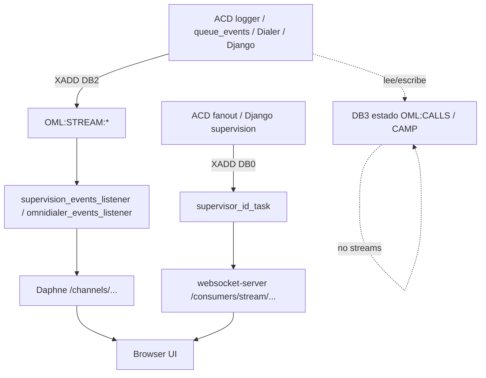

# Redis Streams — OMniLeads

Inventario de Redis Streams en el monorepo `omldeploytool` / `components-git-repo`.

Dos mecanismos de entrega al browser:

| Mecanismo | Path | Rol |
|-----------|------|-----|
| **websocket-server** | `/consumers/stream/...` | Lee Redis Streams (`XREAD`). Path `a/b/c` → key `a_b_c`. |
| **Daphne (Channels)** | `/channels/...` | Channel layer (DB 4). Suele alimentarse de un worker que ya leyó un Stream. |

---

## DBs Redis (voz / dialer / OML)

| DB | Rol | Streams |
|----|-----|---------|
| **0** | OML general, fan-out supervisión, chat/orquestador, conf Asterisk | Sí (`supervisor_*`, webhooks, masters, `asterisk_conf_updater`, …) |
| **2** | Calldata / event streams | `OML:STREAM:CALLEVENTS`, `DISPOSITIONEVENTS`, `DIALER` |
| **3** | Estado runtime del discador (`OML:CALLS:*`, `CAMP:*:COUNTER`, locks, …) | **Ninguno** |
| **4** | Django Channels layer | No son Streams de negocio |

Los productores del dialer leen/escriben estado en **DB 3** y notifican eventos con `XADD` en **`OML:STREAM:DIALER` (DB 2)**.

---

## 1. Streams DB 2 — voz / discador

### `OML:STREAM:CALLEVENTS`

| | |
|---|---|
| **Productores** | ACD [`workers/logger.py`](../components-git-repo/acd/source/workers/logger.py): `WAIT`, `EXIT_ABANDON`, `CAMP` (no contactación dialer). ACD [`ari-app/queue_events.py`](../components-git-repo/acd/source/ari-app/queue_events.py): eventos de cola. |
| **Consumidor** | [`supervision_events_listener`](../components-git-repo/django/supervision_app/management/commands/supervision_events_listener.py) (`EventStreamConsumer`) |
| **Grupo** | `supervision-events` |
| **UI** | Indirecto → Daphne `/channels/supervision/{inbound\|outbound\|dialer}` |

### `OML:STREAM:DISPOSITIONEVENTS`

| | |
|---|---|
| **Productores** | Django [`disposition_cache.py`](../components-git-repo/django/reportes_app/services/redis/disposition_cache.py) (calificaciones / señales) |
| **Consumidor** | `supervision_events_listener` |
| **Grupo** | `supervision-events` |
| **UI** | Daphne `/channels/supervision/...` |

### `OML:STREAM:DIALER`

| | |
|---|---|
| **Productores** | Dialer [`handler/event_stream.py`](../components-git-repo/dialer/workers/handle-campaign/src/handler/event_stream.py) / [`naive.py`](../components-git-repo/dialer/workers/handle-campaign/src/handler/naive.py) (`STATS`, `CALLS`, …). Django [`omnidialer.py`](../components-git-repo/django/ominicontacto_app/services/dialer/omnidialer.py) (p. ej. contadores bot → stream). |
| **Consumidores** | [`omnidialer_events_listener`](../components-git-repo/django/ominicontacto_app/management/commands/omnidialer_events_listener.py) (grupo `omnidialer-events`). `supervision_events_listener` también puede leerlo (grupo `supervision-events`) según configuración Wombat/OMniDialer. |
| **Grupos** | `omnidialer-events`, `supervision-events` |
| **UI** | Daphne `/channels/omnidialer`, `/channels/supervision/dialer` |

Constantes: [`redis_streams.py`](../components-git-repo/django/ominicontacto_app/services/redis/redis_streams.py) (`EVENT_STREAM_DB = 2`).

---

## 2. Streams DB 0 — fan-out por supervisor

Patrón: `supervisor_{id}_{task}` con `task` ∈ `agentes` | `entrantes` | `dialers` | `voicebots`.

| | |
|---|---|
| **Productores** | ACD [`supervision_fanout.py`](../components-git-repo/acd/source/ari-app/services/supervision_fanout.py). Django [`supervision_stream_service.py`](../components-git-repo/django/supervision_app/services/supervision_stream_service.py) (prepare/seed + publish). |
| **Consumidor** | **Sin consumer group.** websocket-server: `XREAD` / `XREVRANGE` en `/consumers/stream/...` |
| **Nota** | `supervisor_{id}_dialers` es estado de **agentes** del panel dialers, no STATS del motor OMniDialer. `voicebots` se escribe; no hay JS en este árbol que abra ese stream. |

### UI (streams directos)

| Pantalla / JS | Path WS | Stream |
|---------------|---------|--------|
| Supervisión agentes (`supervision.js`) | `/consumers/stream/supervisor/{id}/agentes` | `supervisor_{id}_agentes` |
| Contact center | mismo (via `CONTACT_CENTER_AGENTES_STREAM_URL`) | `supervisor_{id}_agentes` |
| Campañas entrantes (`campanas_entrantes.js`) | `/consumers/stream/supervisor/{id}/entrantes` | `supervisor_{id}_entrantes` |
| Campañas dialers (`campanas_dialers.js`) | `/consumers/stream/supervisor/{id}/dialers` | `supervisor_{id}_dialers` |

---

## 3. Streams DB 0 — chat / orquestador

### Masters (registro de entidades)

| Stream | Productor | Consumidor |
|--------|-----------|------------|
| `whatsapp_enabled_lines` | `whatsapp_app/.../linea.py` | `msgs-orchestrator` (`XREAD`) |
| `facebook_enabled_pages` | `facebook_meta_app/.../page.py` | idem |
| `instagram_enabled_accounts` | `instagram_app/.../account.py` | idem |

### Slaves (webhooks por entidad)

| Patrón | Productor | Grupo |
|--------|-----------|-------|
| `whatsapp_webhook_gupshup_line_{pk}` | `webhook_gupshup.py`, `webhook_meta.py` | `msgs-orchestrator:whatsapp:{pk}` |
| `whatsapp_webhook_meta_line_{pk}` | `webhook_meta.py` | `msgs-orchestrator:whatsapp:{pk}` |
| `facebook_meta_webhook_page_{page_id}` | `webhook_meta.py`, `webhook_facebook_messenger.py` | `msgs-orchestrator:facebook:{pk}` |
| `instagram_webhook_account_{ig_user_id}` | `webhook_meta.py` | `msgs-orchestrator:instagram:{pk}` |

- Worker: [`msgs-orchestrator.py`](../components-git-repo/django/orquestador_app/management/commands/msgs-orchestrator.py).
- Legacy: `listening_whatsapp_events.py` también hace `XREAD` de masters.
- La UI de chat **no** lee estos streams; el orquestador procesa y notifica por Daphne (`/channels/agent-console-whatsapp`, etc.).

---

## 4. Otros streams DB 0

### `asterisk_conf_updater`

| | |
|---|---|
| **Productores** | `asterisk_config.py`, playlist, audio Asterisk |
| **Consumidor** | ACD worker `astconf` vía `/consumers/stream/asterisk/conf/updater` |
| **Grupo** | — |

### `auth_event_{YYYY-MM-DD}` / `calification_event_{YYYY-MM-DD}`

| | |
|---|---|
| **Productor** | `notification_app` → `RedisStreamNotifier` |
| **Consumidor** | Ninguno en este monorepo (posible externo / addon) |

### `survey_app_answers_updates` (addon)

| | |
|---|---|
| **Productor** | Addon `survey_app` |
| **Puente** | `reportes_app/services/ccv_thread.py` → `/consumers/stream/survey_app/answers/updates` |

---

## 5. Consumer groups (resumen)

| Grupo | Streams |
|-------|---------|
| `supervision-events` | `OML:STREAM:CALLEVENTS`, `DISPOSITIONEVENTS`, (opcional) `DIALER` |
| `omnidialer-events` | `OML:STREAM:DIALER` |
| `msgs-orchestrator:whatsapp:{pk}` | webhooks WA por línea |
| `msgs-orchestrator:facebook:{pk}` | webhooks FB por página |
| `msgs-orchestrator:instagram:{pk}` | webhooks IG por cuenta |

---

## 6. Vistas / UI — Daphne Channels

Routing: [`notification_app/routing.py`](../components-git-repo/django/notification_app/routing.py).

| Pantalla / JS | Path WS | Origen típico |
|---------------|---------|----------------|
| Contact center — Estado Discador | `/channels/omnidialer` | `OML:STREAM:DIALER` → `omnidialer_events_listener` |
| Listado campañas dialer (`campana_list.js`) | `/channels/omnidialer` | idem |
| Contact center — outbound | `/channels/supervision/dialer` | `supervision_events_listener` |
| Campañas dialers (métricas) | `/channels/supervision/dialer` | idem |
| Campañas entrantes (métricas) | `/channels/supervision/inbound` | `CALLEVENTS` / dispositions |
| Campañas salientes | `/channels/supervision/outbound` | idem |
| Consola agente | `/channels/agent-console` | notificaciones |
| WhatsApp agente | `/channels/agent-console-whatsapp` | orquestador / notifiers |
| Email agente | `/channels/agent-console-email` | Channels |
| Reportes CSV / background | `/channels/background-tasks`, `/channels/reporte_*` | Celery/tasks (no streams de voz) |

ACL dialer STATS: al conectar a `/channels/omnidialer`, `DialerStatsSubscriptionManager` registra al supervisor solo en campañas dialer asignadas (`OML:DIALER-STATS:SUBSCRIBERS:{camp_id}` en DB 2).

---

## 7. Flujo resumido



---

## 8. Referencias de código

| Pieza | Path |
|-------|------|
| Constantes streams DB 2 | `components-git-repo/django/ominicontacto_app/services/redis/redis_streams.py` |
| Consumer genérico | `components-git-repo/django/ominicontacto_app/services/redis/event_stream_consumer.py` |
| Fan-out supervisión Django | `components-git-repo/django/supervision_app/services/supervision_stream_service.py` |
| Fan-out supervisión ACD | `components-git-repo/acd/source/ari-app/services/supervision_fanout.py` |
| Logger ACD → CALLEVENTS | `components-git-repo/acd/source/workers/logger.py` |
| Dialer → STREAM:DIALER | `components-git-repo/dialer/workers/handle-campaign/src/handler/event_stream.py` |
| WS Redis bridge | `components-git-repo/websocket-server/src/fts/oml/services/websockets/server/redis.py` |
| Routing Daphne | `components-git-repo/django/notification_app/routing.py` |

---

## 9. Smoke HA (Ansible multi-host / Compose réplicas)

### Identidad de nodo

| Entorno | Django workers / listeners | Dialer workers |
|---------|----------------------------|----------------|
| **Ansible** | `OML_NODE_ID={{ inventory_hostname }}` en `django.env` | idem en `dialer.env` (leader lease) |
| **Compose** | Sin `OML_NODE_ID` → hostname del contenedor | idem; `OML_NODE_ID` solo en `omlapp` / `daphne` |

Lab Ansible de referencia: `ansible/instances/test_ait/` (Node-1 + Node-2 en `omlapp_workers` y `dialer_workers`).

### Compose — subir réplicas

En `.env` (tras regenerar `docker-compose.yml` desde la plantilla):

```bash
SUPERVISION_EVENTS_LISTENER_REPLICAS=2
OMNIDIALER_EVENTS_LISTENER_REPLICAS=2
DIALER_SCHEDULER_REPLICAS=2
# opcional: MSGS_ORCHESTRATOR_REPLICAS=2  BACKGROUND_TASKS_REPLICAS=2
```

Schedulers Django (`presence-heartbeat`, reportes, `daily-redis-cleanup`) se dejan en **1**: ya usan `ha_lock.run_once`.

### Checks Redis (DB 2 salvo donde se indique)

```bash
# Consumers distintos por réplica / host
redis-cli -n 2 XINFO CONSUMERS OML:STREAM:CALLEVENTS supervision-events
redis-cli -n 2 XINFO CONSUMERS OML:STREAM:DIALER omnidialer-events

# Dialer scheduler: un solo líder (DB dialer, suele ser 3)
redis-cli -n 3 GET OML:HA:SCHEDULER:LEADER
```

Logs esperados en el scheduler líder: `Scheduler leader acquired`; en el follower: lease held by peer / pause.

### Smoke funcional

1. Agenda de contacto: un solo discado (no doble reserva de canal).
2. Arranque de campaña: un solo `process-campaign` encolado por tick de agenda.
3. Supervisión UI (entrantes / dialer): eventos llegan sin duplicar métricas de forma sostenida.
4. Failover: parar Node-1 (o una réplica Compose) → en ~TTL del lease (~15s) el peer toma liderazgo; consumers del nodo vivo siguen con XREADGROUP.

Imágenes deben incluir el cutover Streams y el leader lease del `SchedulerWorker`.
